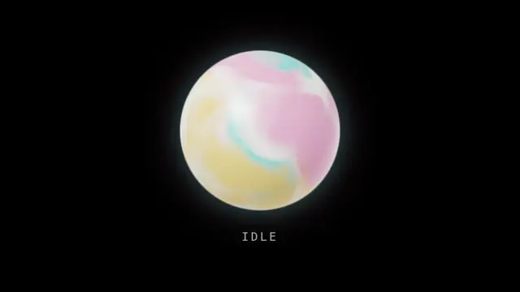
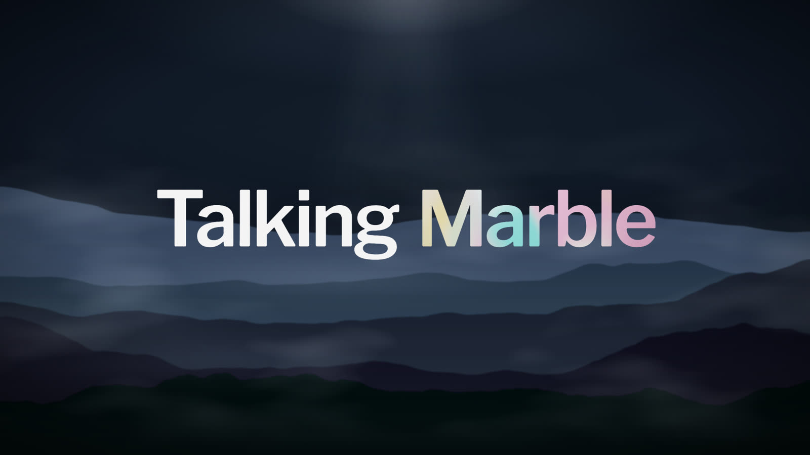
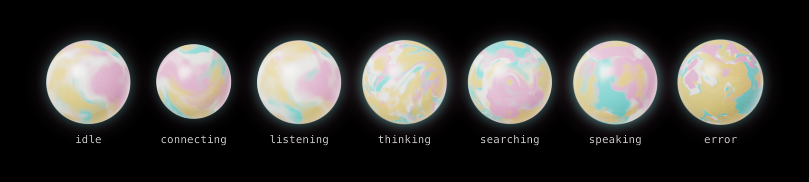
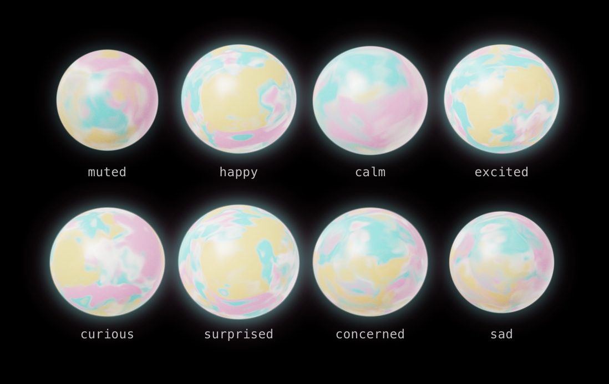
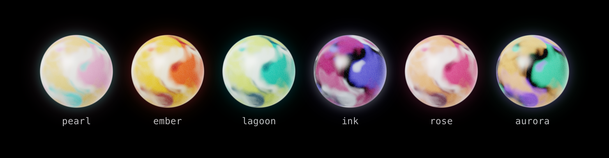
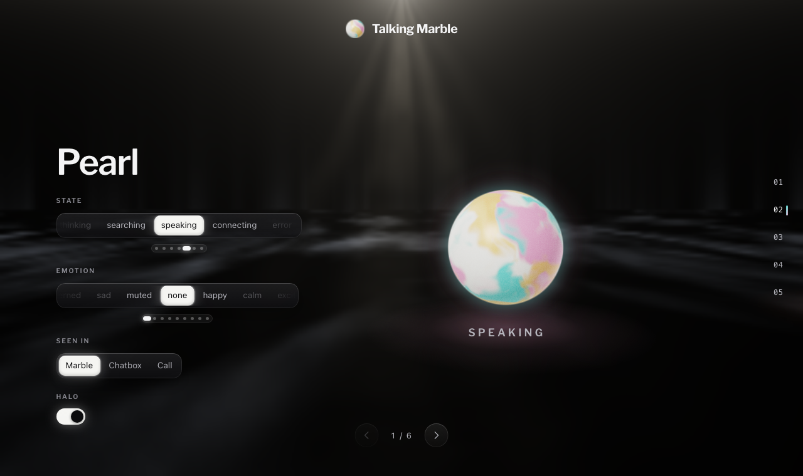

<p align="center">
  
</p>

<h1 align="center">Talking Marble</h1>

<p align="center">
  An audio-reactive orb for voice AI apps.<br />
  It shows what your agent is doing, and moves with its voice.
</p>

<p align="center">
  <a href="https://talking-marble.vercel.app/"><strong>Website</strong></a> ·
  <a href="https://talking-marble.vercel.app/docs/"><strong>Docs</strong></a> ·
  <a href="https://talking-marble.vercel.app/#create"><strong>Make your own</strong></a> ·
  <a href="https://cdn.jsdelivr.net/gh/imjustinliao/Talking-Marble@main/apps/site/public/film/launch.mp4"><strong>Launch film</strong></a>
</p>

<p align="center">
  <a href="https://www.npmjs.com/package/talking-marble"></a>
  
  
  
  
</p>

---

## What it is

Talking Marble is a small, living marble of flowing pigment that you put in your voice AI app. When your agent listens, thinks, looks something up or speaks, the marble changes how it moves, and while the agent talks it swells and ripples with the sound of its voice.

It is only the visual. You bring your own voice AI (OpenAI Realtime, ElevenLabs, LiveKit or anything else) and pass the marble two things: **what the agent is doing**, and, if you have it, **the agent's audio**. Everything else is handled for you.

- **One line to add.** A React component, or a `<talking-marble>` element for Vue, Svelte, Angular, plain HTML and the rest.
- **Speaks your SDK's language.** Its states use the names voice SDKs already use, so you can usually pass your SDK's state straight in.
- **Listens to any audio.** A `MediaStream`, an `<audio>` element, a Web Audio node, or just a number from 0 to 1.
- **Yours to style.** Six palettes, or any four colours; eight emotions; your own states.
- **Light and careful.** About 15 kB gzipped, no dependencies, one shared WebGL context for every marble on the page, paused when off screen, accessible by default.

## Watch the launch film

<p align="center"><a href="https://cdn.jsdelivr.net/gh/imjustinliao/Talking-Marble@main/apps/site/public/film/launch.mp4"></a></p>

35 seconds, with sound: the marble through all seven states. Also on the [website](https://talking-marble.vercel.app/) (Watch the film).

## Install

```bash
npm install talking-marble
```


## Quick start

### React

```tsx
import { TalkingMarble } from 'talking-marble';

export function Assistant({ state, stream }) {
  // state: 'idle' | 'connecting' | 'listening' | 'thinking' | 'searching' | 'speaking' | 'error'
  // stream: the agent's audio, if you have it
  return <TalkingMarble state={state} audio={stream} palette="pearl" size={160} />;
}
```

### Any other framework, or plain HTML

```html
<script type="module">
  import 'talking-marble/element';

  const marble = document.querySelector('talking-marble');
  marble.state = 'listening';   // from your voice SDK's events
  marble.audio = agentStream;   // a MediaStream, an <audio> element or a Web Audio node
</script>

<talking-marble state="idle" palette="pearl" size="160" label="Nova"></talking-marble>
```

That's all you need. Change `state` as your agent moves through a conversation, and the marble eases from one look to the next. Nothing ever jumps.

## How it works

```
 your voice SDK                         Talking Marble
┌──────────────────────┐   state      ┌───────────────────────────────┐
│ OpenAI Realtime,     │ ───────────▶ │ how the marble moves          │
│ ElevenLabs, LiveKit, │              │ (flow, ripples, light, beat)  │
│ your own…            │   audio      │                               │
│                      │ ───────────▶ │ how much it moves right now   │
└──────────────────────┘              └───────────────────────────────┘
```

**The state** sets the marble's character: slow and still when idle, broad and gentle when listening, fast and folding when thinking. **The audio** sets how much it moves at this moment: each syllable sends a ripple out and makes it glow a little brighter. The audio is analysed in the browser and never sent anywhere.

The marble's material never changes between states. Only its energy, motion and brightness do, so it always looks like the same object, just in a different mood.

### States

<p align="center"></p>

| State | When to use it | How it looks |
|-------|----------------|--------------|
| `idle` | Nothing is happening | The pigment flows slowly |
| `connecting` | The session is opening | A slow whirlpool and a steady beat |
| `listening` | The user is talking | Broad, calm veins; the user's voice swells it gently |
| `thinking` | The agent is working out a reply | Fast, fine and turning |
| `searching` | The agent is looking something up or calling a tool | The centre is magnified and the pattern streams out of it, with a ping of light |
| `speaking` | The agent is talking | The agent's voice drives its motion and light |
| `error` | Something went wrong | Restless, with a hard beat and a short shake |

### Emotions

An emotion adds a tone on top of any state, so `speaking` can be happy, calm or concerned without you designing new states.

<p align="center"></p>

```tsx
<TalkingMarble state="speaking" emotion="happy" audio={stream} />
```

`happy` · `calm` · `excited` · `curious` · `surprised` · `concerned` · `sad` · `muted`

### Palettes

<p align="center"></p>

Pick one by name, or pass your own four colours (the ground first, then three pigments):

```tsx
<TalkingMarble palette="aurora" />
<TalkingMarble palette={['#f6f5ee', '#ef9fc5', '#61d9d0', '#f3c76f']} />
```

### Audio

Pass whichever one you have. The marble smooths it so it never twitches.

```tsx
<TalkingMarble state="speaking" audio={mediaStream} />    // a WebRTC or microphone stream
<TalkingMarble state="speaking" audio={audioElement} />   // an <audio> or <video> element
<TalkingMarble state="speaking" audio={audioNode} />      // any Web Audio node
<TalkingMarble state="speaking" level={0.6} />            // or a volume from 0 to 1
```

Only `listening` and `speaking` react to sound (and any of your own states that ask for it). If the browser blocks audio until the user interacts, the marble picks it up again on the next click, tap or key press.

## Connect your voice SDK

Most voice SDKs already report the same moments the marble shows. Map them once:

| Marble | OpenAI Realtime | ElevenLabs | LiveKit |
|--------|-----------------|------------|---------|
| `connecting` | while `session.connect()` runs | `status === 'connecting'` | `connecting`, `initializing` |
| `listening` | `input_audio_buffer.speech_started` | connected, `mode !== 'speaking'` | `listening` |
| `thinking` | `response.created` | (not reported) | `thinking` |
| `speaking` | `output_audio_buffer.started` | `mode === 'speaking'` | `speaking` |
| `error` | `error` | `status === 'error'` | `failed` |
| audio | the remote `MediaStream` | `getOutputVolume()` as `level` | `useAgent().microphoneTrack` |

Here is the whole thing with OpenAI's Agents SDK:

```tsx
import { useState } from 'react';
import { RealtimeAgent, RealtimeSession, OpenAIRealtimeWebRTC } from '@openai/agents-realtime';
import { TalkingMarble, type OrbState } from 'talking-marble';

export function Assistant() {
  const [state, setState] = useState<OrbState>('idle');
  const [audio, setAudio] = useState<MediaStream | null>(null);

  async function start(ephemeralKey: string) {
    const transport = new OpenAIRealtimeWebRTC({
      changePeerConnection: pc => {
        pc.addEventListener('track', e => setAudio(e.streams[0] ?? null));
        return pc;
      },
    });
    const session = new RealtimeSession(new RealtimeAgent({ name: 'Assistant' }), { transport });
    session.on('transport_event', event => {
      switch (event.type) {
        case 'input_audio_buffer.speech_started': setState('listening'); break;
        case 'input_audio_buffer.speech_stopped':
        case 'response.created': setState('thinking'); break;
        case 'output_audio_buffer.started': setState('speaking'); break;
        case 'output_audio_buffer.stopped':
        case 'output_audio_buffer.cleared': setState('listening'); break;
      }
    });
    session.on('error', () => setState('error'));

    setState('connecting');
    await session.connect({ apiKey: ephemeralKey }); // a client secret minted by your server
    setState('listening');
  }

  return <TalkingMarble state={state} audio={audio} />;
}
```

Complete, tested recipes for ElevenLabs and LiveKit are in the [docs](https://talking-marble.vercel.app/docs/#recipes).

## Make it your own

<p align="center"></p>

The [website](https://talking-marble.vercel.app/) lets you try every state, emotion and palette, see it in a chatbox or a call, and design your own: name it, pick its colours, shape how it moves, then copy the code.

In code, a state or emotion of your own is plain data. Give any subset of the settings; the rest stay at their resting values:

```tsx
const presets = {
  celebrating: { speed: 1.6, glow: 0.3, bounce: 0.6, reactivity: 1, label: 'celebrating' },
  thinking: { speed: 2 }, // adjust a built-in one
};

<TalkingMarble state="celebrating" presets={presets} />
```

Every setting, with its range, is listed under [Preset format](https://talking-marble.vercel.app/docs/#presets).

## Props

Every prop is optional.

| Prop | Type | Default | What it does |
|------|------|---------|--------------|
| `state` | a state name, or one of your presets | `'idle'` | What the agent is doing |
| `emotion` | an emotion name, or one of your presets | none | A tone layered on the state |
| `audio` | `MediaStream` \| `HTMLMediaElement` \| `AudioNode` | none | The voice it moves with |
| `level` | number, 0 to 1 | none | A volume instead of `audio` (wins when both are set) |
| `palette` | a palette name, or four hex colours | `'pearl'` | Its colours |
| `size` | number (CSS px) | fills its container | Width and height |
| `presets` | object | none | Your own states and emotions, by name |
| `label` | string | `'Assistant'` | Who it is; screen readers say "Assistant, speaking" |
| `decorative` | boolean | `false` | Hide it from screen readers when the state is shown elsewhere |
| `halo` | boolean, or a strength from 0 to 1.5 | `true` | The soft light around it |
| `paused` | boolean | `false` | Stop animating without unmounting |

Also exported: `palettes`, `states`, `emotions` and each emotion by name, `resolveState`, `resolvePalette`, and the TypeScript types `OrbState`, `OrbEmotion`, `OrbPreset`, `OrbPalette` and `TalkingMarbleProps`.

## Accessibility and performance

- **Screen readers** hear what it is and what it is doing ("Nova, listening"), or nothing at all with `decorative`.
- **Reduced motion** is respected: the marble shows a still frame, and states still show through its brightness and size.
- **No flashing.** Changes ease in, never strobe.
- **Every marble on a page shares one WebGL context**, draws at most 30 frames a second, and stops while off screen or in a background tab.
- **Smooth on slower devices**: if frames start arriving late, it lowers its drawing resolution in steps, down to half, and sharpens again once there is headroom. Its size on the page never changes.
- **Sharp at any size**, from a 20 px icon to full screen. Large marbles draw at up to 1.5× pixel density (their soft pigment looks the same) and small ones at up to 2×.
- **Server rendering** works: on the server, and where WebGL is unavailable, it shows a CSS picture of the marble.

It runs wherever a modern browser does: phones, tablets, laptops and desktops, and desktop apps built on web technology such as Electron and Tauri. Native versions for iOS, Android, React Native and Flutter are planned.

## Development

This repository holds the package and its website.

```
packages/core     the shader, the presets and the spec every version follows
packages/react    the npm package: the React component and the Web Component
apps/site         the website: showcase, playground and docs
```

You need Node 24 and pnpm.

```bash
pnpm install
```

```bash
pnpm dev
```

```bash
pnpm test && pnpm typecheck && pnpm test:e2e
```

`pnpm dev` opens the website at http://localhost:5173 on the package's source, so changes show up as you save. The pictures in this README are rendered from the real component with `pnpm --filter site readme-media`.

## Licence

[MIT](LICENSE) © Justin Liao
